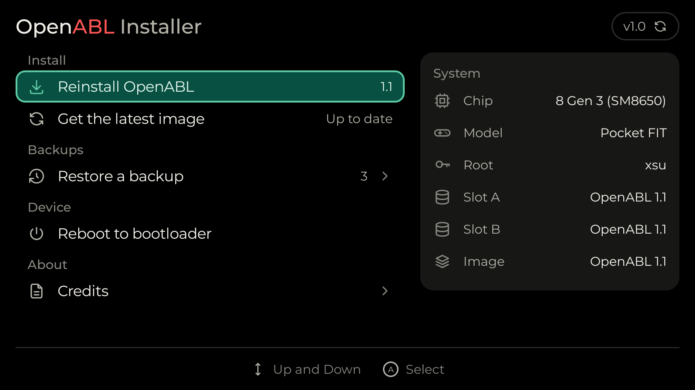
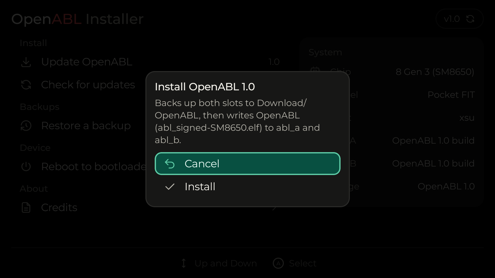
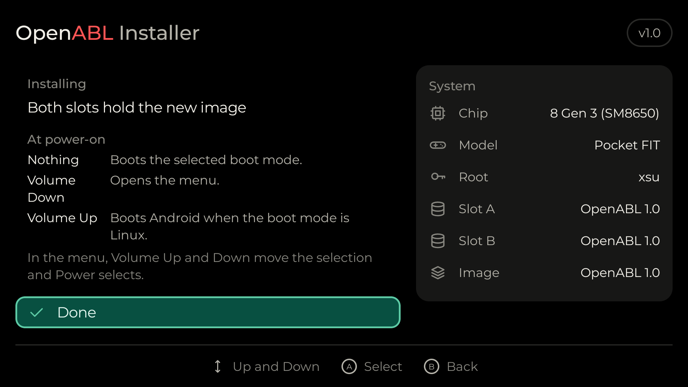
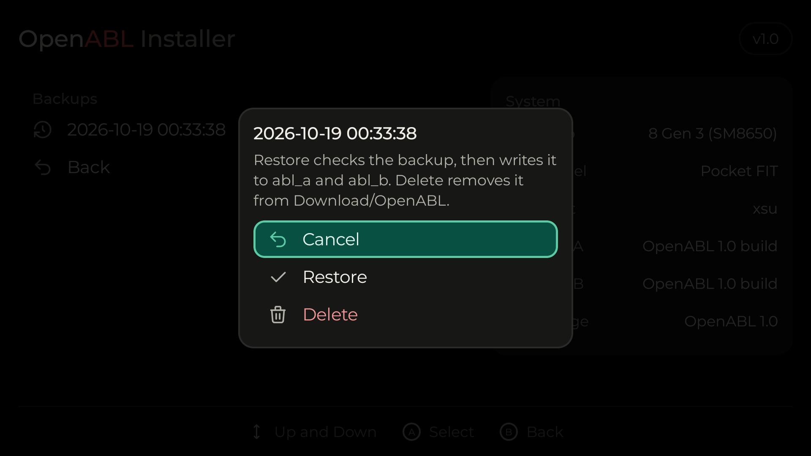

<picture>
  <source media="(prefers-color-scheme: dark)" srcset="Docs/logo-dark.png">
  
</picture>

An Android app that installs OpenABL to `abl_a` and `abl_b` from the
handheld's own Android, without a PC. Download the APK from the
[releases](https://github.com/OpenHandheldCollective/OpenABL-Android-Installer/releases).

<p>
  
  
</p>

It needs root: xsu on AYANEO and KONKR, the system service on Retroid, or
su on AYN and anything with Magisk or KernelSU. Without root the app saves a
one-line script in Download for you to run as root yourself, on Retroid
with Handheld Settings, Advanced, Run script as root.

## Using it

The app shows the chip, the model, how it gets root and what each slot
holds. *Install OpenABL* asks first, then:

1. Backs up both slots to `Download/OpenABL/backup-<date>_<time>/` and checks
   the copies. If this fails nothing is written.
2. Writes the image for the chip to the slot the device isn't running first,
   then the other, and reads each back. A slot that doesn't match is written
   back from the backup.

*Restore a backup* writes a backup back to both slots. It only takes backups
made on the same model. *Reboot to bootloader* restarts into OpenABL's menu
once it is installed.

<p>
  
  
</p>

Supported chips are the ones in the OpenABL release: SDM845, SM4450, SM6115,
SM6450, SM7675, SM8250, SM8550, SM8650 and SM8750. The app only writes when
`abl_a` and `abl_b` exist under `/dev/block/by-name` and are at most 16 MiB.

After installing, hold Volume Down at power-on for the menu. The
[OpenABL README](https://github.com/OpenHandheldCollective/OpenABL#readme) has the keys.

## Root

The app tries these in order:

| Route | How |
|---|---|
| `/product/bin/xsu` | AYANEO and KONKR firmware. |
| `PServerBinder` | Retroid's root service. |
| `su` | Magisk, KernelSU or similar. Android asks you to allow it. |
| Script | Saves `openabl-installer.sh` in Download for you to run as root. |

## Updates

The APK has no images. On start the app asks GitHub for the latest OpenABL
release and downloads the image for your chip, checked against the release's
`SHA256SUMS`, or the `.sha256` beside the image. The last good image is kept
and used offline. With no network and no saved image there is nothing to
install. *Get the latest image* asks again. A download that doesn't match its
checksum is refused.

The app also remembers the hashes of every OpenABL release, to tell what a
slot holds. The version at the top right checks for a newer installer.

## Building

Needs JDK 17 or later and the Android SDK (platform 36).

```bash
./gradlew assembleDebug test
```

The installer's version is in `VERSION`. A release is a tag `v<VERSION>`; the
workflow builds, signs and attaches the APK.

## License

GPL-2.0-or-later, see `LICENSE`.
